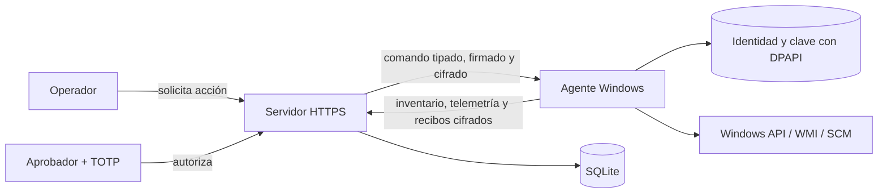

# PuniShell

PuniShell es un prototipo de administración segura para equipos Windows. La
implementación vigente está escrita en Rust y separa servidor, agente,
protocolos criptográficos, reglas de autorización, licenciamiento e integración
nativa con Windows.

> [!IMPORTANT]
> El código de `agente_python/`, `backend_php/` y los instaladores antiguos se
> conserva únicamente como referencia de migración y auditoría. No debe usarse
> en despliegues nuevos. El desarrollo activo está en `punishell-rust/` y usa
> `despliegue_ps1/install_agent_rust.ps1`.

## Cambios de la arquitectura nueva

- Servidor HTTPS con panel operativo, API tipada, sesiones, CSRF, TOTP y SQLite
  transaccional.
- Agente Windows como servicio, con identidad Ed25519 propia y estado protegido
  localmente mediante DPAPI.
- Mensajes firmados y cifrados en la capa de aplicación con AES-256-GCM por
  dispositivo. TLS continúa siendo obligatorio.
- Separación de claves para servidor, comandos, licencias y actualizaciones.
- Códigos de activación de un solo uso, licencias con vigencia y cupo de agentes.
- Acciones administrativas con doble control: operador solicitante, aprobador
  distinto y MFA reciente.
- Inventario y telemetría histórica de sistema, red, usuarios interactivos y
  estado de BitLocker.
- Panel con estado `online`, `stale` y `offline`, tendencias de 24 horas y alertas
  de protección BitLocker.
- Actualizaciones verificadas mediante manifiesto Ed25519, SHA-256 y firma
  Authenticode fijada por certificado.
- Auditoría encadenada para detectar alteraciones en los eventos registrados.

## Arquitectura



El workspace Rust se divide por responsabilidades:

| Componente | Responsabilidad |
|---|---|
| `protocol` | Contratos, acciones tipadas, firmas Ed25519 y sobres AES-256-GCM. |
| `domain` | Roles, aprobación separada, MFA, estados y políticas de ejecución. |
| `licensing` | Vigencia, prestaciones, cupos, revocación y gracia offline. |
| `server` | HTTPS, panel, API, persistencia, telemetría, colas y auditoría. |
| `agent` | Enrolamiento, check-in, diario local, ejecución y actualización. |
| `windows-platform` | DPAPI, WMI, SCM, red, sesiones, BitLocker y Authenticode. |

### Flujo de confianza

1. El servidor se inicializa una sola vez y genera claves independientes por
   propósito, además de `trust.json` con las raíces públicas.
2. Un administrador crea licencia y código de activación temporal desde el
   panel HTTPS.
3. El instalador valida Authenticode y el pin SHA-256 del editor antes de copiar
   el agente.
4. El agente se enrola con el código de un solo uso, genera su identidad y recibe
   una clave de transporte individual dentro de una respuesta firmada.
5. Cada heartbeat se firma y se cifra. El servidor valida tenant, identidad,
   secuencia, licencia y protección contra replay antes de aceptarlo.
6. Una acción sólo llega al agente después de la solicitud, aprobación diferente
   con TOTP y firma del servidor. El agente comprueba destino, vigencia y nonce.

No existe un shell remoto genérico en la arquitectura Rust. Las operaciones son
un conjunto cerrado de acciones: inventario, diagnóstico limitado, bloqueo de
estación, reinicio de servicios permitidos, actualización, rotación de identidad
y reanudación controlada de protectores BitLocker.

## Uso del prototipo

### 1. Requisitos

- Servidor Linux con Rust 1.97 o posterior.
- Certificado TLS válido para el nombre DNS del servidor.
- Windows 10/11 para el agente, con toolchain MSVC y Windows SDK al compilar.
- Certificado de firma de código para el ejecutable del agente.
- Dos cuentas humanas diferentes para probar solicitud y aprobación.

### 2. Compilar e inicializar el servidor

```bash
cd punishell-rust
cargo build --release -p punishell-server --locked

./target/release/punishell-server init \
  --config /var/lib/punishell/server.json \
  --state-dir /var/lib/punishell/state \
  --public-url https://mdm.example.org \
  --certificate /etc/punishell/fullchain.pem \
  --private-key /etc/punishell/privkey.pem
```

`init` solicita una contraseña de al menos 14 caracteres y muestra una sola vez
el secreto TOTP del administrador. La configuración inicial escucha en
`127.0.0.1:8443`; ajustar `bind` en `server.json` de acuerdo con la red o proxy
del laboratorio.

Iniciar el servicio:

```bash
./target/release/punishell-server serve \
  --config /var/lib/punishell/server.json
```

Comprobaciones operativas:

```bash
curl --fail https://mdm.example.org/health/live
curl --fail https://mdm.example.org/health/ready
```

### 3. Preparar el panel

1. Iniciar sesión como `admin` y registrar el TOTP.
2. Crear cuentas separadas con roles `operator` y `approver`.
3. Emitir una licencia con las prestaciones requeridas y cupo suficiente.
4. Crear un código de activación de un solo uso.
5. Copiar `state/trust.json` al equipo Windows mediante un canal confiable.

### 4. Compilar e instalar el agente Windows

En Windows:

```powershell
cd punishell-rust
cargo build --release -p punishell-agent `
  --target x86_64-pc-windows-msvc --locked

signtool sign /fd SHA256 /tr https://timestamp.digicert.com /td SHA256 /a `
  .\target\x86_64-pc-windows-msvc\release\punishell-agent.exe
signtool verify /pa /v `
  .\target\x86_64-pc-windows-msvc\release\punishell-agent.exe
```

Después se instala desde PowerShell elevado. El script solicita el código de
activación por entrada interactiva y no lo guarda:

```powershell
.\despliegue_ps1\install_agent_rust.ps1 `
  -AgentExe .\punishell-agent.exe `
  -TrustPath .\trust.json `
  -ServerUrl https://mdm.example.org `
  -Tenant main `
  -SignerCertificateSha256 <sha256-del-certificado>
```

Para una CA privada se agrega `-CaCertificate .\ca.pem`. La configuración queda
en `%ProgramFiles%\PuniShell` y el estado protegido en
`%ProgramData%\PuniShell`.

### 5. Probar una acción aprobada

1. Confirmar que el agente aparece `online` en el panel.
2. Iniciar sesión como operador y solicitar una acción permitida.
3. Cerrar la sesión o usar otro navegador; iniciar sesión como aprobador.
4. Aprobar con TOTP.
5. Esperar el siguiente heartbeat y verificar resultado y auditoría.

## Telemetría y BitLocker

Cada heartbeat conserva una muestra de telemetría por equipo. El prototipo
retiene un máximo de 5.000 muestras y 30 días. La clasificación actual es:

- `online`: último contacto hace menos de 2 minutos.
- `stale`: entre 2 y 15 minutos.
- `offline`: más de 15 minutos.

BitLocker se consulta mediante `Win32_EncryptableVolume`. El inventario incluye
volumen, protección, conversión, porcentaje, método, bloqueo y auto-unlock. La
única acción de escritura disponible es reanudar protectores existentes sobre
una unidad validada (`C:` a `Z:`).

PuniShell no extrae ni transmite recovery keys, no inicia cifrado desde cero y
no suspende protección. Un futuro sistema de escrow deberá ser independiente,
cifrado, auditado y accesible únicamente mediante un procedimiento de emergencia.

## Seguridad operativa

- No publicar `server.json`, claves privadas, bases SQLite, certificados PFX ni
  códigos de activación.
- No obtener `trust.json` desde el mismo servidor sin validar previamente el
  canal; distribuirlo por un medio confiable.
- Mantener sincronización horaria en servidor y endpoints.
- Hacer copias protegidas de la base SQLite, las claves del servidor y los
  checkpoints de auditoría.
- Probar BitLocker sólo en máquinas virtuales o equipos descartables antes de
  usar hardware real.
- El backend PHP legado contiene mecanismos incompatibles con este modelo de
  seguridad y no debe exponerse a Internet.

## Estructura del repositorio

```text
punishell-rust/       Implementación vigente y documentación técnica
despliegue_ps1/       Instalación y desinstalación del agente Rust
agente_python/        Agente legado, sólo referencia
backend_php/          Servidor legado, sólo referencia
*.md / *.docx         Informes y especificaciones del proyecto
```

La guía operativa detallada se encuentra en
[`punishell-rust/README.md`](punishell-rust/README.md) y las equivalencias de la
migración en
[`punishell-rust/docs/EQUIVALENCIAS_FUNCIONES_RUST.md`](punishell-rust/docs/EQUIVALENCIAS_FUNCIONES_RUST.md).

## Validación

Desde `punishell-rust/`:

```bash
cargo fmt --all -- --check
cargo clippy --workspace --all-targets --locked --offline -- -D warnings
cargo test --workspace --locked --offline
cargo check -p punishell-windows-platform \
  --target x86_64-pc-windows-msvc --locked --offline
node --check crates/server/web/app.js
```

La prueba de concepto se considera completa cuando dos equipos Windows pueden
enrolarse, transmitir telemetría cifrada, aparecer en el panel, ejecutar una
acción con doble aprobación y dejar evidencia verificable en la auditoría. Al
menos uno debe validar inventario y reanudación segura de BitLocker en un entorno
de laboratorio.

## Estado

El proyecto está en fase de prueba de concepto. Todavía requiere pruebas E2E en
Windows con TPM virtual, firma de código de laboratorio, respaldo/restauración,
pruebas de pérdida de red y un runbook de operación antes de considerarse listo
para producción.
